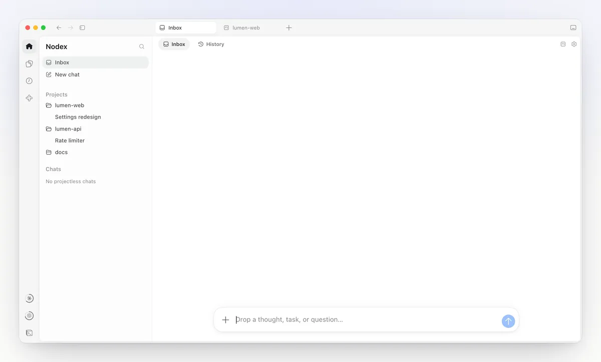
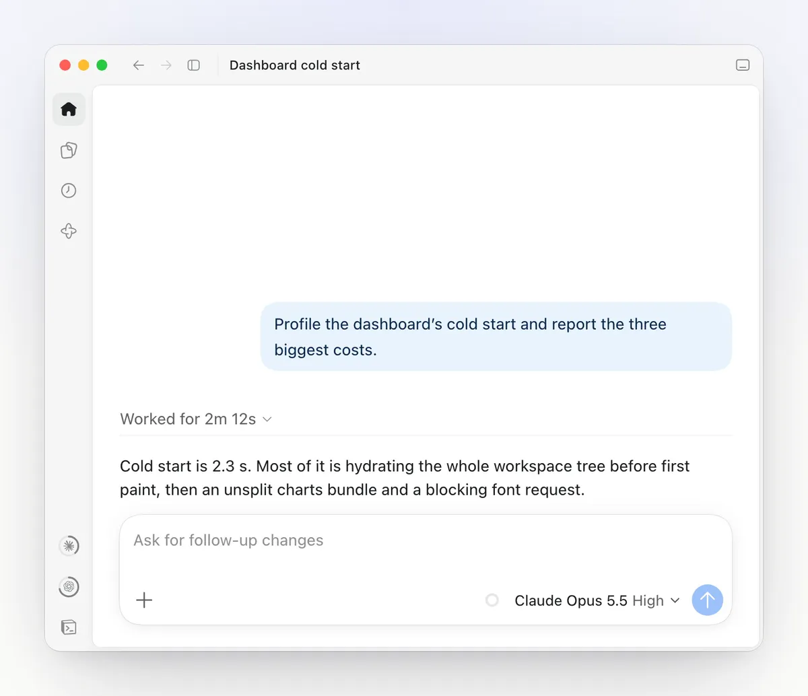
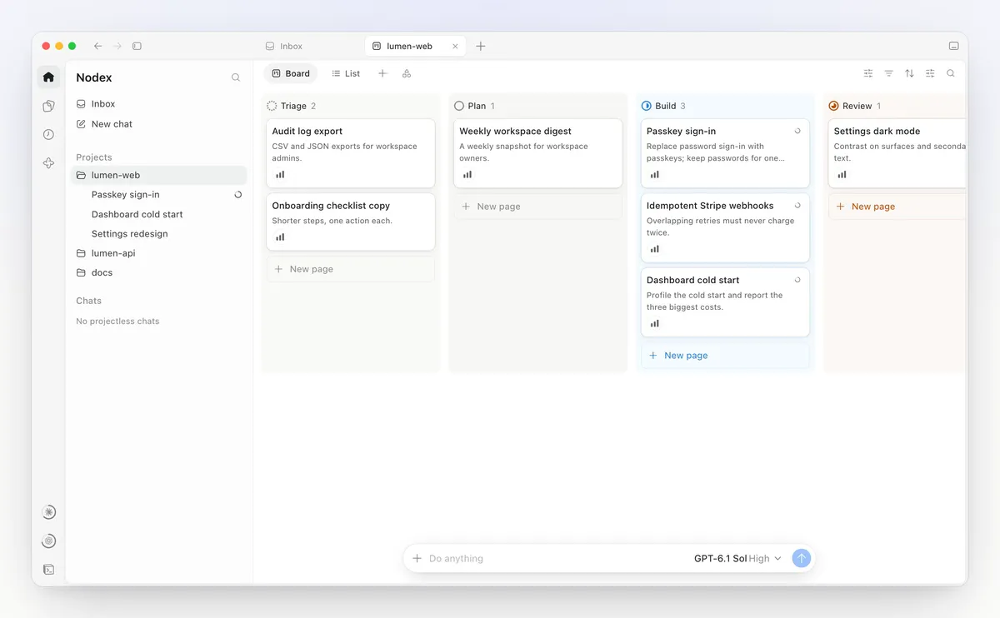

<p align="center">
  <a href="https://nodex.jyu.app">
    <picture>
      <source srcset=".github/assets/nodex-wordmark-dark.svg" media="(prefers-color-scheme: dark)">
      <source srcset=".github/assets/nodex-wordmark-light.svg" media="(prefers-color-scheme: light)">
      
    </picture>
  </a>
</p>

<h3 align="center">One inbox. Every agent. All local.</h3>

<p align="center">
  The open-source workspace where Claude Code, Codex and OpenCode work from the same local Pages.
</p>

<p align="center">
  <a href="https://nodex.jyu.app">Website</a> ·
  <a href="https://github.com/junyudev/nodex/releases/latest">Download</a> ·
  <a href="https://nodex.jyu.app/changelog/">Changelog</a> ·
  <a href="README.zh-CN.md">简体中文</a>
</p>

<p align="center">
  <a href="https://github.com/junyudev/nodex/releases/latest"></a>
  
  <a href="LICENSE"></a>
</p>

<picture>
  <source srcset=".github/assets/readme/hero-dark.webp" media="(prefers-color-scheme: dark)">
  <source srcset=".github/assets/readme/hero-light.webp" media="(prefers-color-scheme: light)">
  
</picture>

## Install

```bash
brew install --cask junyudev/tap/nodex
```

Or download [Nodex for Apple silicon](https://github.com/junyudev/nodex/releases/latest/download/Nodex-latest-arm64.dmg)
and drag it to Applications. Nodex is in beta for macOS 15 and later. Sign in with the Codex,
Claude Code or OpenCode account you already have — or start with OpenCode's free models.

## Why Nodex

Coding agents are good at doing the work. Everything around it is still manual: turning a pile of
ideas into prompts, choosing a model for each, remembering which chat owns which task, and getting
the result back into your notes.

Nodex does that part. Drop your thoughts into one Inbox and each becomes a Page with a plan: which
Project, which agent and model, and what to hand off. The work runs in real chats with terminals,
diffs and a browser beside them, and the results land in Pages that you and your agents both edit.
Everything stays on your Mac.

## What makes it different

### One inbox that plans the work

Drop in a burst of messages. In one pass Nodex suggests what to do with each: start a chat in the
right Project with the right agent, model and effort; send it to a chat that's already on it; file
it; or keep it as a note. A planned chat can name the parts its agent should hand to another model.
Nothing runs until you confirm.

### Let Claude lead. Let GPT build.

<picture>
  <source srcset=".github/assets/readme/fanout-dark.webp" media="(prefers-color-scheme: dark)">
  <source srcset=".github/assets/readme/fanout-light.webp" media="(prefers-color-scheme: light)">
  
</picture>

Any chat can hand parts of its work to another provider with `delegate_task`. A Claude Code session
can fan out to GPT-6.1 Sol in Codex, keep an eye on every task, and merge what comes back. Each
subagent keeps its own conversation you can open, follow up on, or stop.

### Bring the plans you pay for. Add the free ones.

<picture>
  <source srcset=".github/assets/readme/agents-dark.webp" media="(prefers-color-scheme: dark)">
  <source srcset=".github/assets/readme/agents-light.webp" media="(prefers-color-scheme: light)">
  
</picture>

Codex, Claude Code and OpenCode are built in, and 40+ more agents install from the ACP Registry —
Gemini CLI, Qwen Code, GLM Agent and others. OpenCode's free models sit in the same model menu.
Usage meters show what's left of each plan, and the Inbox weighs it before it picks a model.
Switch models mid-chat and your next message hands the conversation to the new Agent.

### The work lands in Pages you both edit

<picture>
  <source srcset=".github/assets/readme/pages-dark.webp" media="(prefers-color-scheme: dark)">
  <source srcset=".github/assets/readme/pages-light.webp" media="(prefers-color-scheme: light)">
  
</picture>

Pages with properties, relations, sub-pages and history, organized in Board and List views. Every
Inbox message is a Page that moves through Triage → Plan → Build → Review → Ship. Agents read and
write Pages through the `nodex` CLI and Agent Skill, and attach reports, screenshots and traces
as Page Files that open in a tab beside the Page, with HTML rendered in a browser tab. Their edits
appear live in the window you have open.

### Ask once. Watch the whole board sort itself out.

<picture>
  <source srcset=".github/assets/readme/tidy-dark.webp" media="(prefers-color-scheme: dark)">
  <source srcset=".github/assets/readme/tidy-light.webp" media="(prefers-color-scheme: light)">
  
</picture>

Your Pages and Databases live in one local Profile that agents can read and change in bulk. Ask
in plain words. Behind the dock the agent runs the `nodex` CLI: one read-only SQL query over
the backlog, then one atomic batch of edits that never overwrites newer changes. The View you
have open regroups as it lands.

## Everything around the agent

- **Worktrees and Environments** give each chat its own isolated checkout.
- **Review** shows unstaged, staged, branch and last-turn diffs beside the chat.
- **Browser, Terminal and Files** open next to the conversation that needs them.
- **Scheduled** runs cron tasks and heartbeats on your Mac.
- **Canvas, the command palette, split panes and multiple windows** keep a busy workspace navigable.
- **Page history and whole-workspace snapshots** let you restore anything.
- **Conversation import** brings your existing Codex and Claude Code chats along.

## Documentation

- [Product specification](docs/product-specs/nodex-product-spec.md)
- [Command-line interface](docs/CLI.md)
- [Architecture](docs/ARCHITECTURE.md)
- [Development guide](docs/development.md)

## License

Nodex is open source under the [Apache License 2.0](LICENSE).
