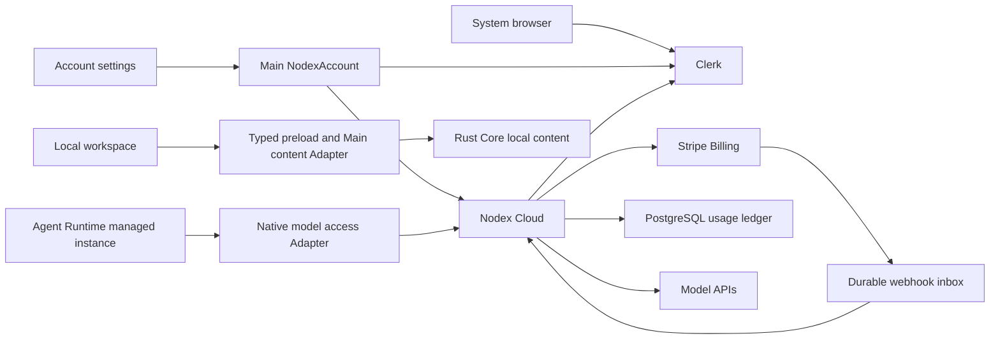

# Nodex Account and Subscription Behavior

- Status: Proposed subscription and model access; native login implemented separately
- Last updated: 2026-10-25
- Decision: [ADR 0070](../adr/0070-optional-cloud-account-and-subscription-authority.md)

## Purpose and first release

A person can optionally sign in to Nodex, purchase a personal subscription,
and use models paid for through that subscription. A fresh installation still
opens directly into local work. Existing Codex, Claude Code, OpenCode and ACP
instances retain their own accounts, configuration and execution behavior.

The proposed first release has one monthly personal plan with a fixed included
usage allowance, no rollover, no automatic overage and no automatic top-up.
Price, allowance, supported models and concurrency limits are server-owned
catalog values to be decided before launch. Team plans, annual plans, trials,
mid-cycle plan changes, cloud content sync and standalone cloud CLI commands
are outside this first release. No model subscription is sold until a usable
first-party execution path passes the delivery gates below.

This document specifies the full proposed integration. The identity-only
Desktop slice is implemented separately in [Nodex Account Login](nodex-account-login-behavior.md):
it verifies the Clerk identity directly with user-info, without a cloud Account
database or billing authority. The cloud verification, subscription and model
access contracts below remain proposed until their delivery gates pass.

## Product invariants

1. A Profile owns one local Library independently of any Nodex Account.
   Signing in does not upload, claim or reassign that Library. One Account can
   connect to many Profiles; a Profile has at most one current Nodex Account.
2. Local startup, content editing, export, backups and current local CLI
   operations require no Nodex login or subscription. Native Agent execution
   keeps its existing provider and network requirements.
3. Nodex Account, Codex account and Claude account have separate sign-in,
   sign-out and usage state. Changing one never mutates another's credentials.
4. First-party model use is an explicit selection. Expired access, exhausted
   capacity or an outage never silently switches billing to another account,
   provider or API key. The person may explicitly change Agent as today.
5. Cloud identity, subscription access and remaining capacity are separate
   facts. Network failure is unknown/unavailable, not signed out or free.
6. Only the cloud ledger can authorize spending. All clients, including
   modified clients and concurrent devices, cross the same admission check.

## Identity and ownership

The proposed glossary in [CONTEXT.md](../../CONTEXT.md#proposed-cloud-account-vocabulary)
defines Nodex Account, Nodex Subscription, Usage Grant and Usage Reservation.
A Clerk identity maps by `(issuer, subject)` to an internal immutable
`accountId`. Email is display/contact data, never a join key. Email changes
preserve identity; recreating a deleted Clerk user does not recover another
Account's subscription merely by using the same email.
Identity and billing remain scoped to Nodex, independently of other products
under `jyu.app`. The production domain roles are fixed in
[Configuration](../CONFIGURATION.md#nodex-account); `api.nodex.jyu.app` is
reserved for this proposed cloud service, not a currently deployed API.

| State | Authoritative owner | Local projection |
| --- | --- | --- |
| Cloud login identity and OAuth grants | Clerk | Main's current account connection |
| Nodex Account lifecycle and Clerk identity mapping | Cloud Account Module | Account summary |
| Customer, recurring subscription, invoices and payments | Stripe Billing | Cloud subscription projection, then desktop summary |
| Plan policy, paid service periods, grants, reservations and usage | Cloud Billing and Model Access Modules | Read-only usage summary |
| Current Profile's credentials and login generation | Main NodexAccount Module | Sanitized renderer snapshot |
| Local Library, Projects and Session placement | Rust Core | Existing content Interfaces |
| Threads, Runs, tools, queues and conversation history | Agent Runtime | Existing execution Interfaces |
| Native Codex/Claude accounts | Existing native homes and provider protocols | Existing Agent settings and usage |

Nodex Cloud is an independently deployed TypeScript application with an HTTP
Adapter and PostgreSQL storage. Start with one deployable and a durable
database-backed worker, with Account, Billing and Model Access as internal
Modules. Clerk, Stripe and model vendors are outbound Adapters. There is no
need for Redis, a separate message broker or several microservices in v1.
Neither the cloud database nor its network availability participates in Core
startup or local content transactions.

The model Adapter forwards model requests, not a Library replica. Only the
prompt, selected attachments and tool results needed for an explicitly
selected first-party execution reach the cloud/model supplier. Local paths,
raw tokens and prompt bodies are excluded from ordinary diagnostic logs.

## Desktop sign-in and credential lifecycle

Main's Profile-scoped `NodexAccount` Module owns OAuth, token refresh, secret
persistence, account observations and account-scoped cloud commands. Renderer
receives a small semantic Interface; it never receives access/refresh tokens,
PKCE verifiers, arbitrary authenticated fetch, or a secret-reading IPC method.
The Module follows the existing Main Effect application Scope and platform
Adapters. It does not create a separate Effect runtime or start an Agent just
to display account state.

Register a fixed public Clerk OAuth application per deployment environment,
require S256 PKCE, and configure opaque access tokens. The desktop needs only
the issuer and public client ID. Clerk/Stripe secret keys and model supplier
keys exist only in cloud deployment secrets. Initial scopes are `openid`,
`profile`, `email`, `offline_access`, and narrowly assigned Nodex cloud scopes
for account reads, billing actions and model use. Keep dynamic client
registration disabled for these first-party applications.

For each sign-in, Main binds an ephemeral listener to `127.0.0.1`, creates
independent random state and verifier values, and opens the system browser.
The registered loopback callback permits a random port. Main validates the
callback path, method, state and pending attempt, exchanges the code, verifies
the account through Nodex Cloud, then publishes the new account generation.
Only the matching callback consumes the pending attempt. Completion, cancel
and timeout release the listener. A browser's previously signed-in user may
be suggested, but a pending attempt can never land in another Profile.
An exchanged token set is not committed until cloud identity verification and
the pending attempt's generation check succeed. Cancellation, Profile shutdown
or failed verification sends an uncommitted or late token set through bounded
revocation/discard cleanup; it is never persisted or published as signed in.

Use the existing `SecretEncryption` Adapter and a private credential file
outside content storage. Key it by deployment environment, issuer, OAuth
client and local Profile identity; use atomic replacement and restrictive
file permissions. Reject Linux `basic_text`. When secure persistence is
unavailable, allow an explicitly indicated memory-only session for the
current process. Never fall back to plaintext. Credential material is excluded
from Profile snapshots, backups, exports, diagnostics and provider home copies.

One refresh owner serves every window in a Profile. It uses returned token
expiry with clock skew and serializes refresh/persistence. Network failure
retains remembered identity with unavailable cloud access; `invalid_grant`
requires sign-in. Late refresh, identity, billing and model-catalog results
must match the captured account generation before publication. Refresh-token
rotation and revocation propagation are verified against the configured Clerk
application during the first implementation slice; they are not assumed from
the web-session SDK.

Sign-out retires the local generation first, cancels pending authentication,
stops new cloud commands and first-party model dispatch, and clears local
credentials and account-specific caches. A bounded revocation operation may
retain the captured token set privately until cleanup ends. If the access
token has expired, it may refresh solely to revoke the grant through cloud
logout; it must never persist or publish a replacement session. All captured
tokens are then discarded. Cloud logout revokes the current opaque OAuth
grant through Clerk; it does not log out the browser or other Profiles.
Offline sign-out can guarantee local removal only; the result must not claim
that remote revocation succeeded. Switching accounts performs this retirement
before starting a new login. Gate 1 must prove grant isolation even when two
Profiles use the same Clerk user and OAuth client.

The existing local CLI remains unchanged in v1. A future cloud CLI namespace
can use browser PKCE or Clerk Device Authorization with its own grant and
secure-storage owner. It must not read Electron's encrypted credential file,
add Clerk to Core's content handshake, or require Desktop for local commands.

## Cloud authentication and account lifecycle

Cloud endpoints explicitly accept Clerk OAuth access tokens and verify opaque
tokens online using the configured issuer's backend credentials. Check active
status, subject, expected OAuth application and granted scopes before mapping
to `accountId`; reject ID tokens and tokens issued for another environment or
client. A public client ID is an application-routing check, not proof that a
client binary is trusted. The first slice must demonstrate all these checks
with the pinned SDK/verification response. If necessary, the Clerk Adapter
uses the verification REST endpoint rather than dropping a check.

V1 does not positively cache token authorization across paid requests. A
Clerk verification outage returns a retryable cloud-unavailable result before
reservation or dispatch. Future verification caching must explicitly account
for revocation latency. Identity approval is followed by independent Account
lifecycle, paid-period, capacity and concurrency checks. A remembered or
previously verified identity alone grants no spending authority.

Cloud Account states are active, suspended and deletion-pending. Verified
Clerk lifecycle webhooks and account reconciliation update these states.
Account deletion immediately blocks new paid admission, cancels recurring
billing through a recoverable operation and revokes grants; personal data is
then removed according to the launch retention policy. Minimal billing and
usage evidence needed for reconciliation is separated from deletable profile
data. Deletion happens on the companion web surface with a Clerk browser
session and server-verified recent human authentication/reverification. That
web Adapter checks origin and CSRF and calls the same Account Module. Native
OAuth tokens alone cannot delete the Account, and refreshing a token does not
count as recent human authentication. This distinct web boundary does not make
native cloud routes accept arbitrary Clerk token types.
Deleting a cloud account never deletes a local Profile or signs out a native
provider. Delayed/replayed identity events cannot recreate a deleted mapping.

## Subscription purchase and access

The Cloud Billing Module owns the mapping from Account to one Stripe Customer
and, in v1, at most one live subscription or pending purchase. A server-owned
plan catalog selects the Stripe Price and allowance. Clients send a plan key
and operation ID; they cannot choose another Customer, raw Price, currency,
allowance or return URL.

Creating Checkout claims an account-scoped purchase operation in a short
transaction, calls Stripe outside that transaction with a stable idempotency
key, then records the result. Repeated requests reuse the same still-valid
Checkout. An uncertain Stripe outcome is reconciled before another purchase
is created. Durable operation records and uniqueness rules outlive Stripe's
idempotency-key retention. Existing subscriptions go to management rather
than a second purchase. Unexpected duplicate subscriptions are quarantined
for reconciliation and never produce duplicate grants.

Main opens returned Checkout and Customer Portal URLs in the system browser.
URLs are short-lived response values, never persistent settings or logs. The
server controls their return destinations. Returning to a Nodex-owned web page
or refocusing Desktop triggers an account-scoped refresh; neither action
proves payment. If webhook processing is still pending, show payment pending
and retry within a bounded window without falsely displaying an active plan.

Customer Portal exposes payment-method changes, invoices and cancellation at
period end. V1 disables quantity changes, trials and plan changes. Browser
Clerk identity is not used to replace the desktop's chosen billing Customer:
every Checkout/Portal URL is minted from the authenticated cloud request.

| Payment condition | First-party model access |
| --- | --- |
| Signed out or signed in without a paid period | No included model capacity; local/native use remains available |
| Initial payment incomplete, failed or requiring action | No grant until the invoice is verified paid |
| Verified paid subscription invoice | One grant for its allowed recurring price, benefit and service interval |
| Successful renewal | A new period grant; previous unused capacity expires |
| Renewal failed / past due | No new grant; an already paid, unexpired period remains usable |
| Cancellation scheduled for period end | Existing paid period remains usable until its end |
| Effective cancellation, suspension or deletion | Stop new paid admission; preserve settlement history |
| Late payment | Grant only its actual service interval; an expired interval never becomes a fresh month |
| Refund or dispute | Suspend the affected paid benefit pending reconciliation; apply explicit adjustment entries without erasing consumed usage |

Verify the invoice, subscription, Customer mapping, allowed price, line type,
service interval and current Account state. A successful Checkout, an `active`
subscription label, a one-off invoice or a proration invoice is not by itself
an allowance grant. Discounts and zero-due invoices can qualify only when
they settle a recognized recurring plan period under server policy. Mid-cycle
upgrades, if later added, require separate delta-grant rules rather than
reusing the full-period grant path.

## Webhook and reconciliation contract

The HTTP Adapter verifies the raw Stripe body and signature, durably inserts
an inbox record, and then returns success. A worker claims records and
reconciles the affected subscription/account; failure remains retryable and
observable. Duplicate event IDs are acknowledged without duplicate work.
Grant creation also has a unique business key, independent of event ID, for
the billing environment, subscription benefit and paid service period, with
invoice/line evidence retained. Different events about one payment therefore
cannot award another allowance.

Stripe events are notifications to reconcile, not an ordered transaction log.
Never use delivery order or `event.created` as a subscription version. Claim
a subscription-scoped reconciliation lease, fetch authoritative Stripe objects
outside the database transaction, and fence the result with the lease
generation when applying it. This prevents a late worker from overwriting a
newer result without holding a database lock over a network request. A periodic
sweep repairs missed events and retries failed operations, including invoices
whose paid evidence is missing locally. Terminal deletion/suspension and
independent invoice evidence survive older subscription notifications.

## Usage ledger and model admission

Use integer compute-credit units with a versioned model rate card. Credits are
a product allowance, not raw token counts, a cash balance or a client estimate.
Supplier cost is recorded separately. The final price/credit conversion must
be fixed and explainable before paid launch. Each grant has an immutable
source, amount and half-open service interval `[startsAt, endsAt)` in server
time. Capacity is scoped to Account and shared across its devices/Profiles.

| Cloud record | Required contract |
| --- | --- |
| Account / identity mapping | Stable Account ID; unique issuer and subject; explicit lifecycle |
| Billing customer / subscription | Unique environment/Customer mapping; one live personal subscription per Account |
| Purchase operation | Account-scoped idempotency, request fingerprint, uncertain outcome and Stripe references |
| Webhook inbox / reconciliation job | Unique source/event ID, attempts, lease generation and failure evidence |
| Usage grant | Immutable paid-period source; unique benefit/period; integer amount and expiry |
| Model request / reservation | Unique Account/request ID and fingerprint; captured account, grant, rate card, upper bound and dispatch state |
| Supplier-cost reservation | One per model request; integer monetary upper bound against the shared deployment budget, independent of user credits |
| Ledger entry | Append-only grant, reservation, settlement, release, expiry or adjustment evidence with an idempotent operation key |

Admission updates the ledger projection, concurrency count and supplier-cost
reservation in one short PostgreSQL transaction. Lock the shared deployment
budget row, then the Account spending row in a fixed order. Re-read Account
lifecycle, benefit suspension and the eligible paid interval inside that
transaction. Deletion, suspension, refund and effective cancellation use the
same Account fence and advance its admission generation. Database constraints
prevent duplicate operations and invalid amounts; all tenant lookups include
the verified Account. No public client receives database credentials. Workers
claim bounded jobs with row leases; external calls happen outside database
locks. Each request is processed as follows:

1. Verify identity. Bind a stable request ID,
   immutable request fingerprint and selected model to the Account.
2. Validate bounded input and maximum output against the rate card. Reserve a
   provable upper bound covering every supported billable dimension and claim
   a concurrency slot atomically with the policy checks above. Reserve the
   supplier's monetary cost upper bound against the global budget in the same
   transaction; separate Account locks alone cannot enforce a shared ceiling.
   Reject insufficient capacity or budget before dispatch.
3. Revalidate the captured admission generation while persisting a dispatch
   intent, then make the supplier call. Revocation before that transition
   releases undispatched reservations; after it, cancellation and settlement
   follow the in-flight rules. A retry with the
   same key and fingerprint returns its existing state; a different payload
   with that key is rejected. Use supplier idempotency where available.
4. Settle once from trusted supplier usage, release the unused reservation,
   settle supplier-cost exposure, and release the concurrency slot. The
   original grant and pricing version remain fixed across a billing-period
   boundary. Unused capacity returns only to its original grant: if that grant
   has expired, it becomes expired capacity rather than a spendable balance.
   Settlement and expiry are idempotent under the same grant/Account fence.

A crash between dispatch intent and a known supplier outcome is ambiguous.
Do not automatically send another billable call or refund the reservation.
Mark it reconciling, retrieve supplier evidence where supported, and resolve
through a bounded operational process. A reservation timeout alone never
proves that the supplier stopped charging. If evidence cannot be recovered,
an explicit policy may refund the user while recording company cost exposure;
the unresolved supplier-cost reservation remains held or is booked at its
worst-case cost. Refunding user credits never erases company exposure or
reopens the global budget. The operation is never silently re-executed.
Repeated ambiguity is subject to server-owned abuse and cost limits.

Streaming cancellation stops further local forwarding and requests upstream
cancellation; already incurred usage is still settled. Existing reservations
remain settleable after expiry, sign-out or account deletion. New requests
require current authorization. Apply per-Account concurrency/request limits,
single-call bounds and a deployment-wide supplier-cost ceiling. Models whose
cost cannot be safely bounded are not enabled in v1. Stripe metering may later
consume settled ledger events, but is not the real-time admission authority.

## First-party execution integration

Model access is a billing source; Agent Backend remains the execution engine.
The preferred feasibility slice is a dedicated managed OpenCode Agent Instance
with its own Profile-local directories and native provider configuration.
Reuse the existing Agent Runtime conversation, tools, cancellation and history.
The person's existing Codex, Claude and OpenCode instances stay independent.

The native model-access Adapter retains Clerk credentials in Main and performs
authenticated cloud dispatch on behalf of the managed instance. If the pinned
OpenCode interface requires an HTTP model endpoint, a loopback broker can
expose only the allowed model protocol behind short-lived process-scoped
capabilities. Those capabilities have no billing-management authority and
retire on account/engine generation changes. Never place Clerk refresh tokens
or supplier keys in native provider configuration. Discovery and execution
must use the same approved managed configuration.

Capture the paying Account when admitting a first-party Run. A continued or
queued request cannot pick up a newly signed-in Account implicitly. Sign-out
or account switch cancels first-party work at its next dispatch boundary and
requests cancellation of in-flight model calls; only their previously
reserved usage may settle against the original Account. Native-provider Runs
continue under their existing credentials. A later explicit continuation
requires a current account and a fresh admission.

Every model call crosses the same admission path, including structured
generation outside a Run. Automatic chat-title requests use the originating
chat operation's captured Account/generation and their own request IDs; their
usage consumes the included allowance under the same rate card. Failure or
insufficient capacity falls back to a local title and never blocks the main
chat. Other existing helper sources, such as prediction or dictation, are not
silently moved onto the first-party plan. Any future first-party helper must
declare its paying Account and whether its capacity is user- or company-funded.

Per-model-request identity and Account attribution are release requirements.
Exact Run attribution additionally needs a verified per-request correlation
mechanism: one fixed instance header cannot identify concurrent Sessions.
Until that mechanism is proven, do not display per-Run cost or promise a
server-enforced whole-Run budget. Account/call/concurrency/global limits still
apply. Any implementation that cannot fence old-account requests independently
of deferred provider configuration is unsuitable for paid launch.

The feasibility slice must prove the pinned OpenCode version's custom-provider
schema, streaming text/tool calls, cancellation, error mapping, credential
refresh, project configuration precedence and model discovery. Its `serverUrl`
setting is the OpenCode control server, not the model gateway URL. The current
user environment editor deliberately rejects inline managed configuration;
add a private typed configuration path rather than bypassing that validator.
The current model picker filters most paid OpenCode models, so managed Nodex
models need an explicit source-aware selection rule.

Runtime availability is also part of the paid feature: either stage a verified
managed runtime or present an explicit supported installation flow before
Checkout. Do not assume an OpenCode executable is already installed. Failure
of this feasibility path calls for a separate execution design decision, not
secret injection into the user's Codex or Claude home.

## Interfaces and user experience

The renderer's Account Interface is limited to reading/observing a snapshot,
starting/canceling sign-in, signing out, refreshing cloud state, opening
Checkout and opening subscription management. Snapshot auth states include
signed-out, signing-in, signed-in and reauthentication-required. Cloud state
separately carries loading/available/unavailable and last-observed time; an
unavailable snapshot can retain the known Account without granting spending.

| Proposed cloud route | Meaning |
| --- | --- |
| `GET /v1/account` | Verified identity and Account lifecycle |
| `POST /v1/account/logout` | Revoke the current native OAuth grant |
| `GET /v1/billing` | Plan, paid-through interval, available/reserved capacity and freshness |
| `POST /v1/billing/checkout` | Idempotently start or recover the Account's purchase |
| `POST /v1/billing/portal` | Create an Account-bound management session |
| `GET /v1/models` | Supported first-party model catalog and product availability |
| `POST /v1/model-requests` | Authenticated, bounded and idempotent model admission/stream |
| `GET /v1/model-requests/:id` | Account-bound recovery/settlement status |
| `POST /v1/webhooks/stripe` | Signature-verified payment notifications |
| `POST /v1/webhooks/clerk` | Signature-verified identity lifecycle notifications |

These are proposed contracts, not existing routes. Model protocol translation
stays in the Adapter; callers do not choose arbitrary upstream hosts. Errors
distinguish sign-in required, reauthentication required, subscription required,
capacity exhausted, rate limited, service unavailable and reconciling outcome.
Only safe reads or operations with an established idempotency key may retry;
a 401 refresh must not blindly replay an uncertain model request.

Add one Settings → Account page with identity, plan, usage/reset date and the
relevant action. Signed-out users see a sign-in action; paid users see Manage
subscription. Avoid a mandatory first-run screen, a second permanent sidebar
account widget or duplicate provider usage summaries. Existing Agent settings
retain Codex/Claude login and usage. The existing rail account control is
Codex-specific and is not repurposed in this slice.

The model picker labels the managed source as Nodex and keeps the actual
execution engine identifiable where users configure it. Signed-out/unpaid
selection can open Account settings; it does not change existing defaults or
create a paid Run. Expired subscriptions and exhausted allowances keep their
local chat history readable. The UI offers explicit recovery or Agent change.

## Repository integration and delivery gates

Suggested new owners are `src/main/nodex-account/` for the Profile-scoped Main
Module, `src/shared/nodex-account.ts` for serializable desktop contracts,
`src/renderer/features/nodex-account/` for the renderer owner, and
`packages/nodex-cloud/` plus `packages/nodex-cloud-contracts/` for the separately
deployed cloud Module and its transport grammar. Cloud web pages are a small
companion surface for Clerk, billing returns and account management. Keep the
cloud deployment and secrets outside the Electron package and release closure.
Names are proposed locations; add no empty abstraction packages in advance.

Existing integration seams include:

- `src/main/codex-application/CodexAccount.ts`: keep native Codex semantics.
- `src/main/app/` and `src/main/platform/electron/SecretEncryption.ts`: account
  lifecycle and secure credential storage; follow ADR 0048.
- `src/renderer/components/workbench/workbench-settings-sections.ts` and
  `workbench-settings-page-registry.ts`: register the single Account page.
- `src/renderer/components/workbench/workbench-rail-account-controls.tsx`:
  retain the existing Codex-specific owner in this slice.
- `src/main/agent-runtime/AgentRuntimeProviderCatalog.ts`: keep account-specific
  model access out of generic caches or include Account/generation identity.
- `src/main/agent-runtime/AgentRuntimeSessionTitle.ts`: structured generation
  outside a Run still needs an explicit paying Account and request identity.
- `packages/agent-runtime/src/nodex/ProviderConfiguration.ts`: busy providers
  defer configuration changes, so this cannot be the revocation authority.
- `src/main/settings/opencode-agent-environment.ts`,
  `src/main/platform/node/OpenCodeSdk.ts` and the vendored OpenCode driver:
  isolated managed configuration must cover discovery and execution.

**Gate 1 — native identity proof.** With isolated Clerk development credentials,
prove browser PKCE, opaque-token verification/revocation, secure persistence,
refresh and multi-Profile isolation in packaged Desktop. Include cancellation
after token exchange, logout with expired access but a valid refresh token,
and two independent grants for the same Clerk user/client: revoking one must
leave the other usable and refreshable. Measure verification latency and
confirm the plan's OAuth/token-validation cost and limits. Pure local startup
and native provider operations must work with every cloud host blocked. This
gate establishes auth feasibility before deeper billing work.

**Gate 2 — account and subscription sandbox.** Deliver Account settings, cloud
Account mapping, server-owned plan catalog, Checkout/Portal, durable webhook
processing and usage grants. Use Stripe test mode/Test Clocks and no real
payments. Production purchase remains disabled. Demonstrate initial failure,
renewal, cancellation, duplicate/late events and concurrent Checkout recovery.

**Gate 3 — model access proof.** Validate the managed runtime and broker path
with scripted supplier responses, then an explicitly bounded live model call.
Prove account isolation, per-call idempotency, token renewal during long work,
tool streaming, cancellation and settlement. Cover native provider retries
and auxiliary title generation during account changes; every call must retain
its operation and payer identity. Freeze supported models and runtime
distribution only after this works. Exact Run attribution is either proven
or intentionally absent from the first release's usage UI.

**Gate 4 — production readiness.** Exercise the entire loop in packaged builds:
local installation → sign-in → sandbox payment → model use → sign-out or
cancellation → local/native continuation. Reconcile the financial and usage
ledger after failure injection. Activate production Checkout only after the
catalog, issuer/client mapping, deployment limits, support/refund procedure,
account deletion flow and retention settings are configured and reviewed.

At implementation time update the current owning architecture/security,
configuration and product documents as their contracts become real; in
particular narrow the existing Security statement about a parallel credential
store to native Codex credentials. This proposal leaves the current runtime
description intact.

## Acceptance evidence

| Scenario | Required observation |
| --- | --- |
| New home with no cloud configuration or network | Local workspace opens; editing/export/local CLI work; no sign-in gate |
| Existing Codex/Claude login, then Nodex sign-in/out | Native credentials and native account state remain unchanged |
| Two Profiles and multiple windows | Correct independent accounts; one refresh owner per Profile; no cross-account responses |
| Same Clerk user/client in two Profiles, then logout in one | Only the selected grant is revoked; the other remains usable and refreshable |
| Canceled/replayed/wrong-state OAuth callback or late token exchange | No account adoption; listener, pending attempt and uncommitted tokens clean up |
| Secure storage unavailable | Explicit memory-only session; no plaintext secret file |
| Expired or revoked native OAuth grant | New cloud requests fail closed; local work remains usable |
| Logout with expired access and a valid refresh token | Private cleanup revokes the grant without publishing or persisting a new session |
| Checkout return before webhook / duplicate purchase | Pending state then one subscription/grant; no optimistic allowance |
| Duplicate/out-of-order events and expired worker lease | No double grant or stale lifecycle overwrite; reconciliation converges |
| Renewal failure, late payment, cancellation, refund | Exactly the paid interval/policy applies; local history remains readable |
| Two devices spend the final available capacity | Atomic admission permits only affordable reservations |
| Different Accounts race for the final deployment budget | Shared supplier-cost reservations prevent aggregate overspend |
| Disconnect/crash after supplier dispatch | No duplicate execution or automatic reservation refund |
| Account switch during queued, streaming or retrying work | Old work cannot spend the new Account; old usage settles once |
| Automatic title generation after account switch or exhausted capacity | No new-account charge; safe local fallback preserves the chat |
| Call settlement races with period expiry | Original grant/rate card applies; expired unused capacity cannot enter the new balance |
| Account deletion/refund races with admission or dispatch intent | Shared admission generation stops new dispatch; in-flight evidence remains reconcilable |
| Deployment kill switch | New paid admission stops; local/native work remains usable |

Implementation verification uses focused domain/ledger tests, Main lifecycle
tests, act-clean renderer tests and a seeded Electron scenario. Run the
repository's runtime-appropriate scripts and one full semantic gate after
source changes; never run Main native tests under host Node. Cloud transaction
tests require a disposable PostgreSQL database and multiple concurrent clients,
not only an in-memory mock. Stripe lifecycle evidence uses test accounts and
Test Clocks; provider evidence uses a controlled gateway. Documentation-only
review requires link/diff validation, not application code checks.

## Inputs still needed before production

Set the plan price/currency, included credits and rate card, first model set,
maximum per-call/account/global cost, supported managed runtime supply,
cloud hosting region, and account-data retention/refund
policy. These are launch inputs, not reasons to delay the identity and sandbox
implementation. The decision to use Clerk and Stripe is fixed for this design.

## External contract references

Checked on 2026-10-22. Vendor behavior must be verified against pinned versions
and the configured development applications during Gate 1.

- [Clerk native browser PKCE](https://clerk.com/blog/adding-clerk-auth-to-your-cli)
- [Clerk OAuth scopes and token lifecycle](https://clerk.com/docs/guides/configure/auth-strategies/oauth/how-clerk-implements-oauth)
- [Clerk OAuth verification](https://clerk.com/docs/guides/configure/auth-strategies/oauth/verify-oauth-tokens)
- [Clerk opaque grant revocation](https://clerk.com/docs/reference/backend/oauth-applications/revoke-token)
- [Clerk Device Authorization](https://clerk.com/docs/guides/configure/auth-strategies/oauth/device-authorization-grant)
- [Stripe Checkout subscriptions](https://docs.stripe.com/payments/checkout/build-subscriptions)
- [Stripe subscription events](https://docs.stripe.com/billing/subscriptions/webhooks)
- [Stripe webhook delivery](https://docs.stripe.com/webhooks)
- [Stripe API idempotency](https://docs.stripe.com/api/idempotent_requests)
- [Stripe Customer Portal](https://docs.stripe.com/customer-management)
- [Stripe Test Clocks](https://docs.stripe.com/billing/testing/test-clocks)
- [OpenCode provider configuration](https://opencode.ai/v2/docs/providers)
